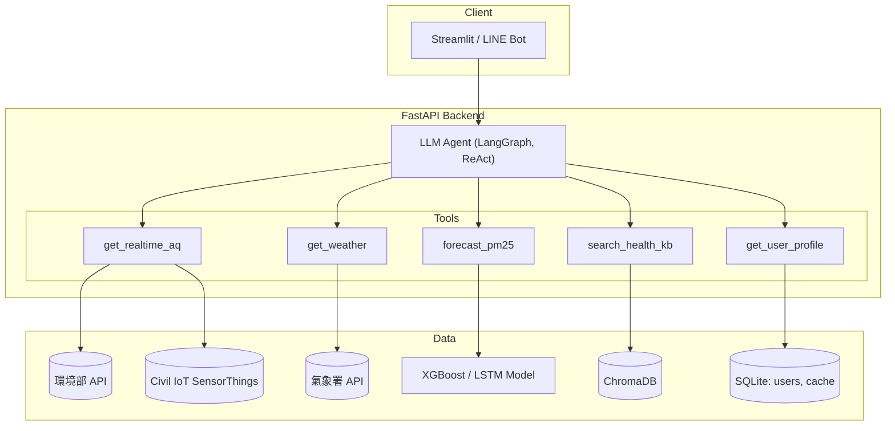
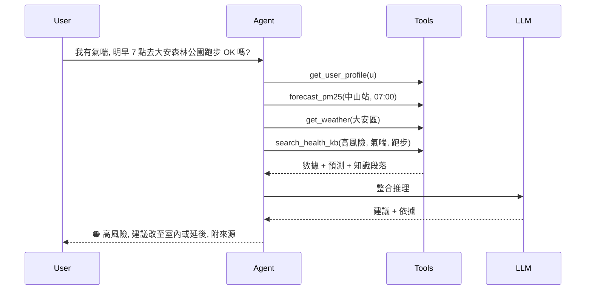

# DESIGN.md — AI Air Doctor 系統設計文件

> 本文件從 Proposal 階段開始建立,隨開發進度持續更新。

| 版本 | 日期 | 階段 | 修改內容 | 修改者 |
|---|---|---|---|---|
| v0.1 | 2026-10-28 | Proposal | 初版:系統目標、架構、Agent 設計 | ____ |

---

## 1. 系統目標
建立一個 **Domain AI Agent**,讓使用者用自然語言詢問空品相關問題,系統自動取得即時 IoT 數據、預測未來 PM2.5、結合環境醫學知識與個人健康檔案,提供**個人化、有依據**的健康建議。

## 2. 需求

### 2.1 功能需求
| ID | 需求 | 優先度 |
|---|---|---|
| F1 | 查詢指定地點的即時空品與氣象 | 必要 |
| F2 | 預測未來 24 小時 PM2.5 | 必要 |
| F3 | 依健康檔案計算個人風險等級 | 必要 |
| F4 | 從知識庫檢索健康建議並附上來源 | 必要 |
| F5 | 自然語言對話介面(Streamlit / LINE Bot) | 必要 |
| F6 | 高污染主動推播提醒 | 選做 |
| F7 | 自建 ESP32 室內感測器 | 選做 |

### 2.2 非功能需求
- 回應時間 < 10 秒
- 每則健康建議都必須附上資料來源
- 顯示免責聲明:「本系統不取代醫師診斷」

## 3. 系統架構



## 4. Agent 設計

### 4.1 角色(System Prompt 摘要)
> 你是 AI Air Doctor,一位結合大氣科學與環境醫學知識的空品健康顧問。回答前必須使用工具取得數據,不可自行猜測數值;所有健康建議必須引用知識庫來源;對敏感族群採用較嚴格的標準;最後加上免責聲明。

### 4.2 工具定義
| Tool | 輸入 | 輸出 | 資料來源 |
|---|---|---|---|
| `get_realtime_aq` | location | pm25、pm10、o3、aqi、station、time | 環境部 / Civil IoT |
| `get_weather` | location | temp、humidity、wind_speed、wind_dir、rain | 氣象署 |
| `forecast_pm25` | station、target_time | pm25_pred、confidence、top_factors | 預測模型 + SHAP |
| `search_health_kb` | query、risk_level、group | top-k 段落 + 出處 | ChromaDB |
| `get_user_profile` | user_id | age、conditions、pregnant、activity_pref | SQLite |

### 4.3 決策邏輯
1. 解析意圖(地點、時間、活動)
2. 讀取健康檔案,判斷屬於一般民眾或敏感族群
3. 依查詢時間決定使用即時數據或預測模型
4. 風險值 = PM2.5 × 活動係數,再與族群門檻比較
5. 用 RAG 檢索建議,由 LLM 整合產生回答
6. 檢查回答有沒有引用來源,沒有就重新生成

## 5. 資料流程



## 6. 資料與模型
- **訓練資料**:環境部測站 2022–2025 年逐時資料加上氣象資料
- **特徵**:lag 1–24h、移動平均、小時、星期、月份、風速向量(u、v)、濕度、溫度、降雨
- **切分**:依時間切分,2022–2024 為訓練集,2025 為測試集
- **模型**:Persistence(Baseline)、XGBoost、LSTM
- **指標**:MAE、RMSE、R²

## 7. 技術選型
| 層 | 技術 |
|---|---|
| LLM | Gemini / GPT / Llama 3 |
| Agent | LangGraph |
| ML | scikit-learn、XGBoost、PyTorch、SHAP |
| 向量資料庫 | ChromaDB |
| 後端 | FastAPI |
| 前端 | Streamlit / LINE Messaging API |
| IoT(選做) | ESP32 + PMS5003 + DHT22,透過 MQTT 傳輸 |

## 8. 目錄結構(規劃)
```
├── README.md
├── DESIGN.md
├── docs/            # proposal、PPT、圖
├── data/            # 原始與處理後資料(大檔不上傳)
├── knowledge/       # 知識庫原始文件(WHO、AQI 指引)
├── src/
│   ├── agent/       # Agent 與 tools
│   ├── models/      # 預測模型訓練與推論
│   ├── data/        # API 串接、前處理
│   └── app/         # FastAPI、Streamlit
└── experiments/     # 實驗 notebook 與結果
```

## 9. 待決定事項
- [ ] LLM 要用哪一家(考量費用、是否支援 Function Calling)
- [ ] 前端要用 Streamlit 還是 LINE Bot
- [ ] 是否製作 ESP32 室內感測器
- [ ] 敏感族群的 PM2.5 門檻數值(需查證文獻)
