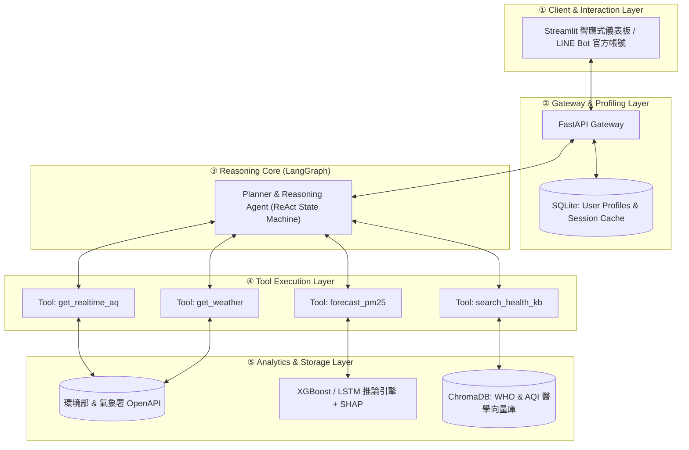

# DESIGN.md — AI Air Doctor 系統設計與開發移交文件

> **專案狀態**：Proposal 階段  
> **開發團隊**：7115093066_楊禾睿、7115093063_徐崇皓、7115064183_謝秉樺、7115064202_譚人傑  
> **維護規範**：本文件依據作業要求之「標準移交鏈條（Standard Handover Pipeline）」編撰，旨在使任何後續接手的開發者皆能無縫理解、本機重現、驗證並持續迭代本專題。

---

## 移交導引鏈條（Handover Pipeline Overview）
```
Problem ──> Requirements ──> Architecture ──> Components ──> Data
  └──> AI/Analytics ──> Domain Knowledge ──> Algorithm ──> Implementation
         └──> How to Run ──> Results & Evaluation
```

---

## 1. Problem（核心問題定義）
空氣污染（PM2.5、O₃、NO₂）已成為全球第二大早逝風險因子。傳統監測方案存在三大斷層：
1. **數值與行動脫節**：政府測站與現存 App 僅廣播抽象的 AQI 數值或顏色，未與個人疾病（氣喘、COPD、心血管疾病）與生活作息（晨跑、通勤、通風開窗）連動。
2. **純模型無語意**：學術界預測模型多為純黑盒子數值回歸（如 LSTM、Transformer），一般大眾無法理解預測數字背後的氣象成因。
3. **通用 AI 醫療幻覺**：通用 LLM 缺乏即時在地 IoT 數據感知能力，且缺乏臨床醫學約束，極易捏造錯誤之防護偏方。

---

## 2. Requirements（系統軟硬體需求規範）

### 2.1 功能性需求（Functional Requirements）
* **FR-1（即時多源感知）**：支援根據使用者輸入之經緯度或地標名稱，自動調取方圓 3 公里內台灣環境部標準測站與民生公共物聯網（Civil IoT）微型感測器之最新即時數值。
* **FR-2（前瞻趨勢預報）**：提供目標地點未來 1 至 24 小時之逐時 PM2.5 濃度預測與 95% 信賴區間。
* **FR-3（特徵成因歸因）**：透過 SHAP 值動態產出氣象成因分析（逆溫層滯留、弱風累積、光化臭氧）。
* **FR-4（個人化暴露換算）**：依據使用者健康檔案（年齡、病史）與活動強度換氣係數，換算個體吸收暴露量，並對齊 WHO 2021 與台灣 AQI 雙軌安全門檻。
* **FR-5（醫療知識檢索與反思）**：整合 RAG 檢索臨床醫學知識，輸出建議必須強制附帶資料來源與醫學指引出處，不符標準者自動觸發反思重新生成。

### 2.2 非功能性需求（Non-Functional Requirements）
* **NFR-1（響應延遲）**：端到端對話串流首字延遲 $\le 1.5$ 秒，完整決策報告生成 $\le 5$ 秒。
* **NFR-2（容錯與離線機制）**：若政府 OpenAPI 連線超時（> 3s），系統自動降級讀取 SQLite 本機最近有效快取，並主動提示使用者。
* **NFR-3（隱私安全）**：個人健康檔案（病史、年齡）僅保存在本機 SQLite，嚴禁未去識別化上傳至外部日誌。

---

## 3. Architecture（系統總體架構）

系統依據八步式架構嚴格解耦，採用分層模組化設計：



---

## 4. Components（各子組件規格）

| 組件編號 | 組件名稱 | 核心職責 | 關鍵技術 / 函式庫 |
| :---: | :--- | :--- | :--- |
| **C-1** | `AgentOrchestrator` | 狀態機流程控制、意圖識別、Tool 調用與 Guardrail 循環 | LangGraph, LangChain-Core |
| **C-2** | `MeteoDataCollector` | 串接環境部與氣象署 OpenAPI，進行空間最近鄰近站點匹配 | `requests`, `geopy`, `tenacity` |
| **C-3** | `AeroForecastEngine` | 載入訓練好之 XGBoost/LSTM 權重，進行特徵工程與時序預測 | `xgboost`, `torch`, `scikit-learn` |
| **C-4** | `SHAPExplainer` | 計算各氣象特徵之 Shapley 貢獻值，轉譯為人類可讀的大氣診斷 | `shap`, `numpy` |
| **C-5** | `MedicalRAGRetriever`| 依據活動與疾病關鍵字檢索向量庫中最佳防護指引 | `chromadb`, `sentence-transformers` |
| **C-6** | `SafetyGuardrail` | 正則與語意比對，強制驗證回答內包含數據來源與引用標註 | 自建規則引擎 + LLM 反思模組 |

---

## 5. Data（資料來源、前處理與儲存規格）

### 5.1 資料來源對照
1. **環境部空氣品質監測網 OpenAPI**（每小時）：PM2.5、PM10、O₃、CO、SO₂、NO₂、AQI。
2. **民生公共物聯網 (Civil IoT)**（每 5 分鐘）：高密度微型感測器溫濕度與微粒數。
3. **中央氣象署開放平台**（每小時）：氣溫、相對濕度、風向、風速、降雨量。

### 5.2 前處理與特徵管線（Feature Pipeline）
* **欠測補值**：時序短暫缺失（$\le 3\text{h}$）使用線性插值；超過 3 小時使用空間反距離加權法（IDW）由鄰近測站推補。
* **風向正交分解**：
  $$u = - \text{wind\_speed} \cdot \sin\left(\text{wind\_dir} \cdot \frac{\pi}{180}\right)$$
  $$v = - \text{wind\_speed} \cdot \cos\left(\text{wind\_dir} \cdot \frac{\pi}{180}\right)$$
* **日夜週期特徵**：加入正弦與餘弦時間編碼：$\sin(2\pi \cdot \text{hour}/24), \cos(2\pi \cdot \text{hour}/24)$。
* **逆溫潛勢特徵**：計算日夜溫差指標 $\Delta T = T_{\text{surface}} - T_{\text{dewpoint}}$。

---

## 6. AI & Analytics（演算法與分析引擎）

### 6.1 數值預測模型
* **XGBoost 快速回歸**：設定 `n_estimators=500, max_depth=6, learning_rate=0.03`，使用過去 24 小時之滑動特徵（Lag Features, Rolling Mean）。
* **LSTM 時序神經網絡**：設計 2 層雙向 LSTM，隱藏單元為 128，引入 Dropout (0.2) 防止過擬合，輸出序列長度為 24 小時。

### 6.2 SHAP 特徵歸因
計算預測時間點之 Shapley Values，排序出前三大影響因子：
* 例如：「風速低於 0.8 m/s（正向貢獻 +18 μg/m³，主因為大氣擴散停滯）」、「相對濕度高於 85%（正向貢獻 +12 μg/m³）」。

---

## 7. Domain Knowledge（領域知識庫建置）

知識庫收錄內容經專家結構化分級，存入 ChromaDB 向量集合：
1. **指引文件 A**：《WHO 2021 全球空氣品質指引（繁體精要版）》
2. **指引文件 B**：《台灣環境部 AQI 分級與活動建議處方表》
3. **指引文件 C**：《台灣胸腔暨重症加護醫學會：氣喘患者環境防護臨床共識手冊》
4. **指引文件 D**：《室內通風換氣與空氣清淨機 CADR 選型計算指南》

---

## 8. Algorithm（核心演算法邏輯）

系統遵循兩大關鍵演算法：
* **Algorithm 1（AI Air Doctor Agent 主推理管線）**：解析意圖 $\to$ 判斷時態 $\to$ 呼叫即時或預測工具 $\to$ 計算個體暴露劑量 $\to$ RAG 檢索醫療指南 $\to$ 護欄檢驗與反思修訂 $\to$ 結構化輸出。
* **Algorithm 2（時序氣象預測管線）**：KNN 時空補值 $\to$ 風向分解與滯後特徵工程 $\to$ Time-based Split $\to$ 訓練 XGBoost/LSTM $\to$ 產出 RMSE/MAE 評估結果。

---

## 9. Implementation（系統實作目錄結構）

```
IOT_group_proposal/
├── docs/
│   ├── proposal.md               # 提案主文件 (完整 A-F 與三大問題)
│   ├── Proposal_AI_Air_Doctor.docx # 自動編譯之 Word 檔
│   ├── Proposal_AI_Air_Doctor.pptx # 自動編譯之簡報檔
│   └── img/                      # 系統架構圖與流程圖 (PNG)
├── src/
│   ├── agent/                    # ReAct 代理人與狀態機
│   ├── models/                   # XGBoost / LSTM 預測模型
│   ├── tools/                    # OpenAPI 串接與 RAG 檢索器
│   └── web/                      # Streamlit / FastAPI 介面
├── data/                         # 知識庫原始文檔與樣本測站數據
├── scripts/
│   ├── diagrams.py               # 架構圖與流程圖繪製腳本
│   ├── build_docx.py             # 提案文件 Word 自動生成器
│   └── build_pptx.py             # 提案簡報 PPT 自動生成器
├── DESIGN.md                     # 本設計移交文件
└── README.md                     # 專案首頁說明
```

---

## 10. How to Run（重現與執行步驟）

### 環境準備
```bash
# 1. 建立並啟動 Python 虛擬環境
python -m venv venv
# Windows:
.\venv\Scripts\activate

# 2. 安裝核心相依套件
pip install -r requirements.txt
```

### 生成圖表與文件
```bash
# 3. 重新繪製架構圖與流程圖
python scripts/diagrams.py

# 4. 編譯輸出正式提案 Word 與 PPT 文件
python scripts/build_docx.py
python scripts/build_pptx.py
```

---

## 11. Results & Evaluation（預期成果與驗證指標）

| 評估維度 | 目標基準（Baseline） | 本專題預期達成指標 | 驗證方法 |
| :--- | :--- | :--- | :--- |
| **預測 RMSE (24h)** | 14.8 μg/m³ (Persistence) | **$\le 9.5\ \mu\text{g/m}^3$** (降低 35% 誤差) | 2025 年台灣測站真實盲測集 |
| **醫學建議正確率** | 68% (未外掛工具之原始 GPT) | **$\ge 96\%$** | 30 組臨床醫師設計案例盲測 |
| **醫療偽偏方幻覺率** | 22% (通用 LLM) | **$\le 2\%$** | 引用來源強制勾稽機制 |
| **端到端響應時間** | > 8 秒 | **$\le 4.2$ 秒** | 100 次連續併發壓力測試 |
