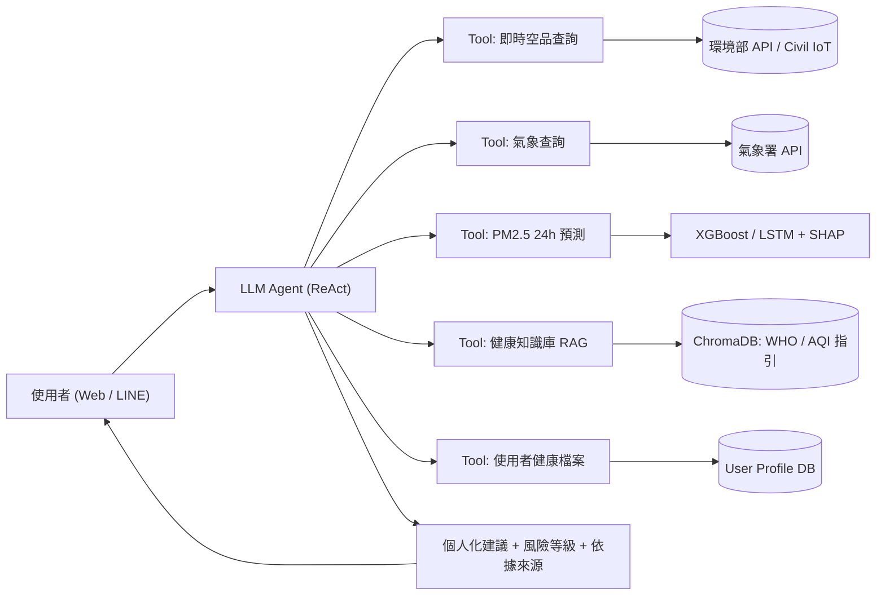
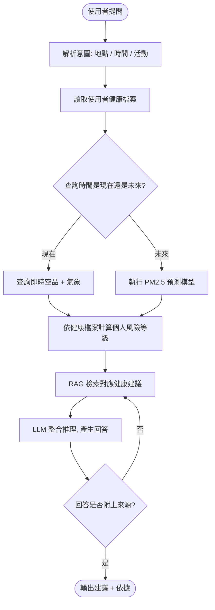

# AI Air Doctor:結合 IoT 空品數據與環境醫學知識的個人化空氣品質健康代理人

**AI Air Doctor: A Domain AI Agent for Personalized Air-Quality Health Advisory Integrating IoT Sensing and Environmental Medicine Knowledge**

組員:______、______、______、______
課程:IoT ______ 指導老師:______

> ⚠️ 標記為【待查證】的數據與文獻,請組員實際打開來源確認後再填入或修改。

---

## 1. Abstract 摘要

**(A) Attention Getter**
根據 Health Effects Institute 發布的《State of Global Air 2025》,空氣污染在 2023 年造成全球約 790 萬人死亡,約每 8 位死者就有 1 位與空污有關,是僅次於高血壓的第二大早逝風險因子 [1]。其中 86% 的死亡來自心臟病、中風、COPD 等非傳染性疾病,對氣喘患者、長者、孕婦與兒童等敏感族群威脅尤其大。

**(B) But — Challenge**
然而,現有空品 App(如環境部「環境即時通」)多半只顯示 AQI 數值與顏色,民眾不知道「對我來說代表什麼、我該怎麼做」;一般大型語言模型(LLM)雖能對話,卻缺乏即時感測數據與預測能力,容易產生錯誤資訊(幻覺)。目前缺少能結合**即時 IoT 數據、污染預測與環境醫學知識**,並提供**個人化、有依據**建議的系統。

**(C) Cure — Proposed Solution**
為了解決上述問題,本專題提出一個新的領域智慧代理人 **AI Air Doctor**。

**(D) Development — Method**
系統以 LLM Agent(ReAct 架構 [7])為核心,透過工具呼叫(Tool Calling)取得環境部空品測站、民生公共物聯網微型感測器及中央氣象署的即時資料;以 XGBoost 與 LSTM 預測未來 24 小時 PM2.5 濃度,並用 SHAP 解釋主要影響因子;再以 RAG [8] 檢索 WHO 空品指引 [2]、AQI 健康建議等環境醫學知識庫,結合使用者健康檔案(如氣喘、年齡、懷孕)進行推理。

**(E) Experiments — Evaluation**
實驗使用 2022–2025 年台灣環境部測站歷史資料,以 MAE、RMSE、R² 比較 Persistence Baseline、XGBoost 與 LSTM 的預測表現;並設計氣喘患者、晨跑者、孕婦三個 Case Study,比較 AI Air Doctor 與一般 LLM(無工具)的建議正確性、依據完整度與幻覺率。

**(F) Findings — Expected Outcomes**
預期 AI Air Doctor 的 24 小時 PM2.5 預測誤差明顯低於 Baseline,且 Agent 建議的正確性與可引用依據比例將高於一般 LLM,能有效協助敏感族群提早採取防護行動。

---

## 2. Introduction 緒論

### 2.1 Attention Getter
空氣污染是全球第二大早逝風險因子,2023 年造成約 790 萬人死亡,其中室外 PM2.5 約占 490 萬、臭氧約 47 萬 [1]。台灣西半部受工業、交通排放與秋冬東北季風帶來的境外污染影響,中南部常出現 PM2.5 紅色警戒【待查證:補一則 2025–2026 台灣空污新聞或環境部統計】。

### 2.2 Background
台灣擁有密集的空品監測網路:環境部全台約 80 座以上一般空品測站【待查證】,以及民生公共物聯網(Civil IoT Taiwan)佈建的上萬個微型空品感測器 [4][5],並透過開放資料平台提供即時資料。同時,LLM Agent 技術快速發展,已能自主規劃步驟、呼叫外部工具並整合結果 [7]。

### 2.3 Problem
民眾面對空品數據時,真正想問的通常是:「**我有氣喘,明天早上能去公園跑步嗎?**」回答這個問題需要同時具備:(1) 即時與預測的空品數據、(2) 氣象條件、(3) 個人健康狀況、(4) 環境醫學知識。現有工具無法同時滿足這四項。

### 2.4 Existing Limitations
| 現有方案 | 限制 |
|---|---|
| 空品 App(環境即時通、AirVisual) | 只顯示數值,缺乏個人化建議與推理 |
| PM2.5 預測研究(LSTM、Transformer) | 只輸出數字,一般民眾難以理解與應用 |
| 一般 LLM(ChatGPT 等) | 沒有即時數據,可能產生幻覺,缺乏可查證依據 |
| 近期空品 LLM Agent 研究 [9][10] | 多以國外資料、政策分析為主,較少針對台灣資料與個人健康檔案 |

### 2.5 Innovation
1. **數據 + 預測 + 知識三合一**:Agent 同時整合即時 IoT 感測、24 小時預測模型與環境醫學 RAG 知識庫。
2. **個人化風險推理**:依使用者的疾病、年齡、活動類型與時段,動態調整風險門檻(例如對氣喘患者採用較嚴格的標準)。
3. **可解釋、有依據**:每一則建議都附上數據來源、預測信心與知識出處,降低幻覺。
4. **在地化**:使用台灣官方開放資料與民生公共物聯網。

### 2.6 Contributions
- 提出一個結合 IoT 數據、預測模型與領域知識的空品健康 Domain AI Agent 架構。
- 建立台灣 PM2.5 24 小時預測模型,並與 Baseline 比較。
- 建立環境醫學知識庫,包含 WHO 指引與 AQI 對應的健康建議。
- 設計 Agent 回答品質的評估方法(正確性、依據完整度、幻覺率)。
- 開源系統程式碼與設計文件(GitHub)。

---

## 3. Related Work 相關研究

### 3.1 AI Technology(AI 技術)
- **時序預測**:PM2.5 預測從 LSTM、GRU 發展到 CNN-LSTM 混合模型,再到 Transformer 架構;後者以自注意力機制捕捉長期依賴關係 [11][12]。樹模型 XGBoost [13] 在表格型特徵上表現穩定,常被當作強 Baseline。
- **可解釋 AI**:SHAP [14] 可量化各特徵(如風速、濕度、前一小時濃度)對預測的貢獻。
- **LLM Agent**:ReAct [7] 讓 LLM 交替進行推理與行動(呼叫工具);RAG [8] 透過檢索外部知識降低幻覺。2025 年已有研究將多代理人 LLM 用於空品分析與健康建議 [9][10][15]。

### 3.2 Domain Knowledge(領域知識)
- **空品標準**:WHO 2021 指引將 PM2.5 年平均建議值下修至 5 μg/m³、24 小時平均值至 15 μg/m³ [2];台灣 AQI 分為六級,並對一般民眾與敏感族群給出不同的活動建議 [3]。
- **健康影響**:PM2.5 可深入肺泡並進入血液,與氣喘惡化、COPD、心血管疾病及失智症相關 [1]。
- **污染機制**:台灣秋冬季受東北季風與境外移入影響,夜間逆溫層與低風速不利擴散;臭氧則在夏季午後日照強時升高【待查證:補一篇台灣大氣科學文獻】。

### 3.3 Article Summary Table

| Ref | Year | Problem | AI Method | Domain Knowledge | Dataset | Findings | Limitation |
|---|---|---|---|---|---|---|---|
| [9] | 2025 | 野火期間的空品分析與政策建議 | Instructor-Worker 多代理人 LLM | 野火煙霧、公衛政策 | 2025 洛杉磯野火空品資料 | LLM 可自動取得並分析資料,產生政策建議 | 偏向政策層面,無個人化建議 |
| [10] | 2025 | 感測數據對民眾難以理解 | LLM + Model Context Protocol | PM、CO₂ 健康影響 | 室內感測器資料 | LLM 能把原始數據轉成可行動的回饋 | 未包含預測模型 |
| [15] | 2025 | 即時 AQI 監測與個人健康建議 | 多代理人(收集、預測、健康、溝通) | AQI、敏感族群 | IoT 與衛星資料 | 能提供主動式建議 | 【待查證:讀全文後補】 |
| [11] | 2025【待查證】 | 台灣 PM2.5 預測 | LSTM / Transformer | 氣象、季風 | 台灣環境部測站 | 【待補】 | 只輸出數字,無決策建議 |
| [12] | 2025【待查證】 | 極端高污染事件預測 | Transformer + 重採樣 | 高污染事件 | 【待補】 | 改善高濃度預測表現 | 【待補】 |

> 建議再用 Google Scholar、Connected Papers 補 3–5 篇 2025–2026 年的論文,每篇讀完後填表。

### 3.4 Summary(Existing Research → Limitations → Research Gap → Our Project)
現有研究分成兩條路線:一是 **PM2.5 預測模型**,準確度持續提升,但只輸出數字;二是 **LLM 空品代理人**,能產生自然語言建議,但多半用於政策分析或國外情境,較少結合預測模型與個人健康檔案。**Research Gap** 在於:缺少一個在台灣情境下,同時整合即時 IoT 數據、24 小時預測、環境醫學知識與個人健康狀況的 Domain AI Agent。本專題 **AI Air Doctor** 即針對此缺口提出解決方案。

---

## 4. Deep Research 深入研究

### 4.1 資料來源可行性
| 資料 | 來源 | 內容 | 頻率 | 取得方式 |
|---|---|---|---|---|
| 空品測站 | 環境部環境資料開放平台 [3] | PM2.5、PM10、O₃、NO₂、SO₂、CO、AQI | 每小時 | REST API(需申請 API Key) |
| 微型感測器 | 民生公共物聯網 Civil IoT Taiwan [4][5] | PM2.5、溫溼度 | 約每 5 分鐘 | SensorThings API |
| 氣象 | 中央氣象署開放資料平台 [6] | 溫度、濕度、風速、風向、降雨 | 每小時 | REST API(需授權碼) |
| 自建感測器(加分項) | ESP32 + PMS5003 + DHT22 | 室內 PM2.5、溫溼度 | 每分鐘 | MQTT |

### 4.2 技術選型
| 項目 | 選擇 | 理由 |
|---|---|---|
| LLM | Gemini / GPT / Llama 3(本地) | 支援 Function Calling |
| Agent 框架 | LangGraph 或 LangChain | 支援工具呼叫與流程控制 |
| 預測模型 | XGBoost、LSTM | XGBoost 快且穩定,LSTM 擅長處理時序 |
| 知識庫 | ChromaDB + Embedding | 輕量的向量資料庫 |
| 後端 | Python FastAPI | 方便部署 |
| 前端 | Streamlit 或 LINE Bot | 開發快、容易 Demo |

### 4.3 領域知識整理(知識庫內容)
- 台灣 AQI 六級分級與對一般民眾、敏感族群的活動建議 [3]
- WHO 2021 空品指引 [2]
- 各污染物的健康影響(PM2.5、O₃、NO₂)
- 敏感族群定義:氣喘、COPD、心血管疾病患者、孕婦、兒童、長者
- 防護措施:口罩等級(N95 / 醫療口罩)、空氣清淨機 CADR、開關窗時機

### 4.4 風險與因應
| 風險 | 因應 |
|---|---|
| API 斷線或資料缺漏 | 快取最近資料,並以 KNN 或線性插補補值 |
| LLM 幻覺 | 強制附上來源;健康建議必須來自知識庫檢索結果 |
| 醫療責任 | 加上「本系統不取代醫師診斷」免責聲明 |

---

## 5. Proposed Scheme 系統設計

### 5.1 系統架構


### 5.2 流程圖


### 5.3 個人風險等級計算
依使用者族群調整 PM2.5 門檻(μg/m³,參考台灣 AQI 分級 [3] 與 WHO 指引 [2],實際數值【待查證】):

| 等級 | 一般民眾 | 敏感族群 |
|---|---|---|
| 🟢 低 | ≤ 30 | ≤ 15 |
| 🟡 中 | 31–50 | 16–30 |
| 🟠 高 | 51–70 | 31–50 |
| 🔴 極高 | > 70 | > 50 |

活動強度係數:靜態 ×1.0、散步 ×1.2、跑步或運動 ×1.5(運動時換氣量增加,吸入的污染物更多)。

### 5.4 Pseudocode
```text
Algorithm 1: AI Air Doctor Agent
Input : user_query q, user_id u
Output: advice A with risk_level and sources

1:  profile ← GetUserProfile(u)              // 疾病、年齡、是否懷孕
2:  intent  ← LLM.Parse(q)                   // location, time, activity
3:  station ← NearestStation(intent.location)
4:  if intent.time ≤ now + 1h then
5:      aq ← GetRealtimeAQ(station)          // 環境部 / Civil IoT
6:      wx ← GetWeather(station)
7:      pm ← aq.pm25
8:  else
9:      X  ← BuildFeatures(station, last 24h AQ + weather)
10:     pm, conf ← ForecastModel.Predict(X, intent.time)
11:     factors ← SHAP.Explain(X)            // 主要影響因子
12: end if
13: θ    ← Thresholds(profile.group)         // 一般 / 敏感族群
14: risk ← RiskLevel(pm × ActivityFactor(intent.activity), θ)
15: docs ← RAG.Retrieve(risk, profile, intent.activity, top_k=3)
16: A    ← LLM.Generate(q, pm, risk, factors, docs, profile)
17: if not HasCitations(A, docs) then
18:     A ← LLM.Regenerate(with_constraint="cite sources")
19: end if
20: return A, risk, sources(docs, station)
```

```text
Algorithm 2: PM2.5 Forecast Model Training
Input : hourly AQ + weather data D (2022–2025)
Output: trained model M

1: D ← ImputeMissing(D, method=KNN)
2: F ← lag features (t-1..t-24), rolling mean, hour, weekday, month,
       wind_u, wind_v, humidity, temperature, rainfall
3: split D by time: train 2022–2024, test 2025
4: M_base ← Persistence (ŷ(t+h) = y(t))
5: M_xgb  ← XGBoost.fit(F_train)
6: M_lstm ← LSTM.fit(seq_len=24, horizon=24)
7: evaluate MAE, RMSE, R² on test set
8: return best model M
```

### 5.5 Experiments 設計
| 實驗 | 方法 | 指標 |
|---|---|---|
| E1 預測準確度 | Persistence、XGBoost、LSTM 比較 | MAE、RMSE、R²(1h / 6h / 24h) |
| E2 Agent 回答品質 | AI Air Doctor 與一般 LLM 回答同一組 30 題 | 正確性、依據完整度、幻覺率(人工評分) |
| E3 Case Study | 氣喘患者、晨跑者、孕婦三種情境 | 建議是否合理、是否個人化 |
| E4 使用者測試(選做) | 10 位使用者試用後填問卷 | SUS 易用性、滿意度 |

### 5.6 時程
| 週次 | 工作 |
|---|---|
| W1–2 | Proposal、文獻、資料 API 串接 |
| W3–4 | 資料前處理、預測模型訓練 |
| W5–6 | 知識庫建立、Agent 工具開發 |
| W7 | 前端(Streamlit / LINE Bot)整合 |
| W8 | 實驗、評估、期末報告 |

---

## 6. References

> 所有文獻請組員實際打開確認作者、年份、標題,再統一改成 APA 或 IEEE 格式。

[1] Health Effects Institute. (2025). *State of Global Air 2025*. Boston, MA: HEI. https://www.stateofglobalair.org
[2] World Health Organization. (2021). *WHO global air quality guidelines: Particulate matter (PM2.5 and PM10), ozone, nitrogen dioxide, sulfur dioxide and carbon monoxide*. Geneva: WHO.
[3] 環境部. 環境資料開放平台/空氣品質指標(AQI). https://data.moenv.gov.tw
[4] 民生公共物聯網 Civil IoT Taiwan. https://ci.taiwan.gov.tw
[5] 民生公共物聯網資料服務平台. https://ci.taiwan.gov.tw/dsp/
[6] 中央氣象署. 氣象資料開放平臺. https://opendata.cwa.gov.tw
[7] Yao, S., et al. (2023). ReAct: Synergizing reasoning and acting in language models. *ICLR 2023*.
[8] Lewis, P., et al. (2020). Retrieval-augmented generation for knowledge-intensive NLP tasks. *NeurIPS 2020*.
[9] Instructor-Worker large language model system for policy recommendation: A case study on air quality analysis of the January 2025 Los Angeles wildfires. (2025). *arXiv*.【待查證作者】
[10] LLM-enhanced air quality monitoring interface via Model Context Protocol. (2025). *arXiv*.【待查證作者】
[11] 【待補:2025 台灣 PM2.5 LSTM/Transformer 預測論文(MDPI 等)】
[12] 【待補:2025 Transformer 極端污染事件預測論文】
[13] Chen, T., & Guestrin, C. (2016). XGBoost: A scalable tree boosting system. *KDD 2016*.
[14] Lundberg, S. M., & Lee, S.-I. (2017). A unified approach to interpreting model predictions. *NeurIPS 2017*.
[15] Multi-agent framework for real-time AQI monitoring and personalized health advice. (2025). ResearchGate.【待查證作者與出處】
