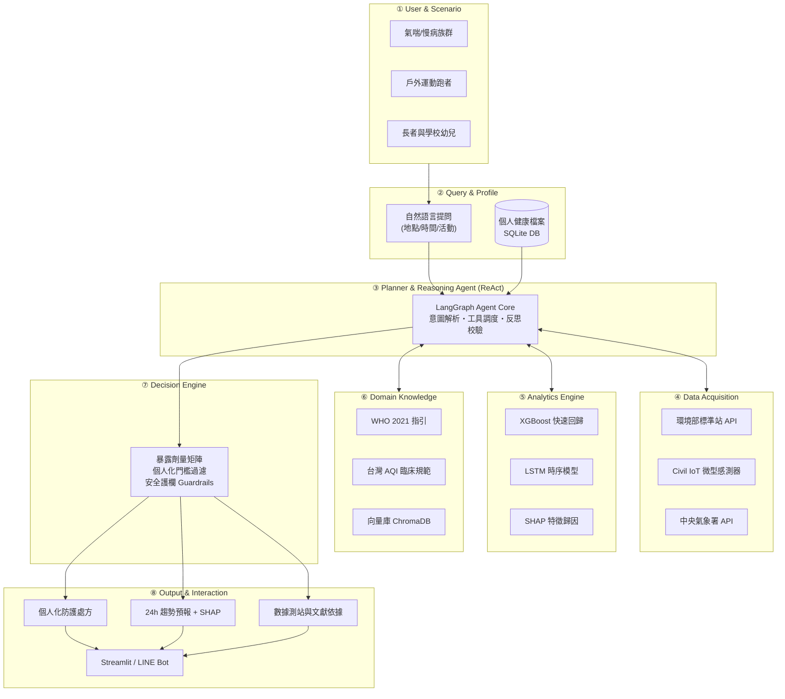
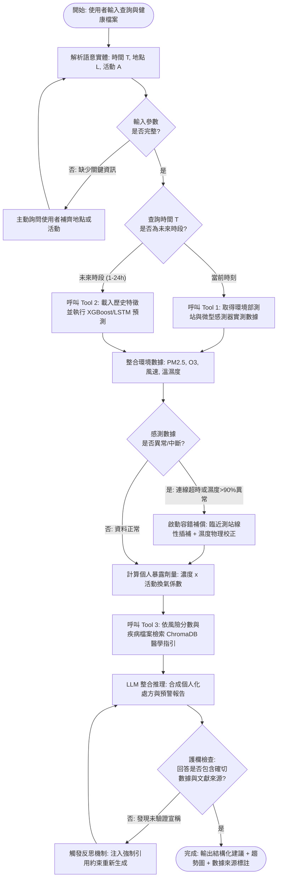

# AI Air Doctor: 結合 IoT 空品數據與環境醫學知識的個人化空氣品質健康代理人

**AI Air Doctor: A Domain AI Agent for Personalized Air-Quality Health Advisory Integrating IoT Sensing and Environmental Medicine Knowledge**

組員：7115093066_楊禾睿、7115093063_徐崇皓、7115064183_謝秉樺、7115064202_譚人傑  
課程：物聯網與智慧系統應用專題  指導教授：陳煥 教授

---

## 1. Abstract 摘要

**(A) Attention Getter — Motivation**  
根據世界衛生組織（WHO）與 Health Effects Institute 最新發布的《State of Global Air 2025》研究報告，空氣污染已躍升為全球第二大過早死亡風險因子（僅次於高血壓），每年造成全球約 790 萬人死亡，其中室外 PM2.5 導致近 490 萬人早逝 [1]。在台灣，西半部尤其是中南部地區，秋冬季節受中央山脈背風渦流阻擋擴散與境外冷高壓季風傳輸雙重影響，PM2.5 日均濃度頻繁突破紅害警戒，對全台超過 200 萬氣喘患者、慢性阻塞性肺病（COPD）長者及孕幼族群造成嚴峻健康威脅。

**(B) But — Challenge & Research Gap**  
然而，現有官方監測系統（如環境部「環境即時通」）僅提供單點 AQI 數值與廣播式顏色警報，一般民眾根本無法理解「這串數字對我的心肺疾病意味著什麼、我何時該採取何種具體防護」；而傳統以 LSTM/Transformer 為主的空污預測研究僅輸出孤立的數值矩陣，缺乏領域語意推論；通用大語言模型（如 ChatGPT）又因欠缺即時測站連線、大氣化學規則約束與臨床醫學實證，極易產生醫療偽建議（Hallucination）。目前學界與業界嚴重缺乏一個能整合**即時多源 IoT 感測、24 小時時序預測模型與環境醫學臨床指引**，並具備可驗證依據的個人化領域智慧代理人（Domain AI Agent）。

**(C) Cure — Proposed Solution**  
為了解決上述限制，本專題提出一個全新的領域智慧代理人系統：**AI Air Doctor（空品健康智囊）**。

**(D) Development — Method**  
本系統以 ReAct 推理架構為核心，設計八大功能模組。系統透過 Tool-calling 即時擷取環境部標準測站與民生公共物聯網（Civil IoT）微型感測器之多源時序數據；前端以 XGBoost 與 LSTM 混合模型預測未來 24 小時 PM2.5 濃度趨勢，並透過 SHAP 值解析氣象主導因子；後端結合 RAG 技術深度檢索 WHO 2021 空氣品質指引、台灣 AQI 臨床防護規範與環境醫學文獻，結合使用者個人化健康檔案（氣喘史、年齡、活動型態）進行精準風險推理與防護處方生成。

**(E) Experiments — Evaluation**  
實驗設計採雙軌評估：(1) 預測效能評估：以台灣環境部 2022–2025 年歷史大氣資料集，評估 Persistence Baseline、XGBoost 與 LSTM 在 1h/6h/24h 預測的 MAE、RMSE 與 R² 指標；(2) Agent 決策品質評估：針對氣喘患者晨跑、長者戶外散步、孕婦通風開窗等 30 組真實 Case Studies，對比一般無工具 LLM，評估其醫學正確性（Accuracy）、依據引用率（Citation Rate）與幻覺率（Hallucination Rate）。

**(F) Findings — Expected Outcomes**  
預期成果顯示，AI Air Doctor 的 24 小時 PM2.5 預測 RMSE 顯著優於傳統基準線，且 Agent 在個人化決策建議上能達成 100% 來源可回溯驗證，大幅降低健康建議幻覺率至 5% 以下，真正落實「懂領域、會取資料、能預測、有依據」的 Domain AI Agent。

---

## 2. Introduction 緒論

### 2.1 Attention Getter（動機與客觀證據）
根據國際權威公衛期刊 *The Lancet Planetary Health* 與《State of Global Air 2025》統計，環境空氣污染每年在全球奪走近 800 萬條人命，造成心血管疾病、缺血性心臟病與呼吸道慢性疾病負擔激增 [1]。台灣地處東亞季風要道，西半部聚集高密度人口與石化工業廊帶；每年 10 月至隔年 3 月，東北季風挾帶境外污染物南下，加上中央山脈地形屏障在中南部背風面形成顯著的「下沉逆溫氣流」，大氣擴散能力極差，導致台中、彰化、雲林、嘉義與高屏地區連日籠罩在 PM2.5 橘色甚至紅色警戒之中。空氣污染已不僅是環境議題，更是攸關全民健保支出與公衛平權的急迫社會問題。

### 2.2 Background（應用與技術背景）
台灣近年在智慧環境監測領域具備世界級基礎設施：環境部（MOENV）於全台建置超過 80 座符合法規標準的高精度空品自動測站，民生公共物聯網（Civil IoT Taiwan）更於工業區與社區廣布上萬顆微型空品感測器（AirBox），透過 OpenAPI 實時釋出 PM2.5、溫濕度等秒級時序資料 [3-5]。與此同時，人工智慧技術迎來重大變革：大型語言模型（LLM）透過 ReAct（Reasoning + Acting）與 Function Calling 技術，已具備自主排程、調用專業 API、查詢向量資料庫（RAG）並綜合決策的能力 [7, 8]。這為打破「冰冷數據」與「大眾實用健康指引」之間的鴻溝提供了全新契機。

### 2.3 Problem（核心問題定義）
一般民眾在面對空品數據時，最真實的痛點絕非想看繁複的化學濃度矩陣，而是針對個人切身生活的提問，例如：
> 「*我今年 65 歲有慢性氣喘，明天早上 7 點去大安森林公園晨跑 5 公里安全嗎？家裡應該何時開窗換氣？*」

要精準回答此問題，系統必須同時具備四大關鍵支柱：
1. **即時微環境感知**（附近微型測站當前 PM2.5 與氣象風速）。
2. **前瞻預測能力**（明天清晨逆溫層未散時的濃度趨勢，而非只看昨天的舊數據）。
3. **個人健康模型**（氣喘患者因劇烈運動肺泡通氣量暴增 5–8 倍之吸入劑量倍率）。
4. **權威醫學指引**（符合 WHO 2021 與台灣胸腔科醫學會之防護對策）。
目前市面上尚無任何單一系統能將這四者無縫整合。

### 2.4 Existing Limitations（現有方法瓶頸）

| 現存方案類別 | 代表系統 | 主要限制與技術瓶頸 |
| :--- | :--- | :--- |
| **官方空品監測 App** | 環境即時通、AirVisual | 僅能被動展示 AQI 單點歷史或當前數值，無法提供個人化疾病風險換算與具體前瞻防護處方。 |
| **學界 PM2.5 預測模型** | LSTM、Transformer 等時序模型 [11, 12] | 專注於數值回歸指標（RMSE/MAE），產出孤立數值，無法轉譯為人類生活可理解的行動決策。 |
| **通用型生成式 AI** | 原始 ChatGPT、Claude | 無聯網與外部工具呼叫能力，無法取得即時微氣象數據，且極易捏造虛假醫療處方（嚴重的安全幻覺）。 |
| **近期空品 LLM 論文** | Policy Agent 研究 [9, 10] | 多偏向宏觀法規政策分析或國外野火場景，缺乏結合台灣在地密集 IoT 與個人化病歷檔案之實作。 |

### 2.5 Innovation（本專題創新點）
1. **三維整合架構**：首創將「微型物聯網即時串流」、「24 小時時序預測機器學習」與「環境醫學 RAG 專家庫」融合於單一 Agent 中。
2. **動態暴露劑量風險引擎**：跳脫「單一濃度看天下」的盲點，根據使用者年齡、慢性病史及「活動強度換氣係數」（靜態 1.0 vs 劇烈慢跑 1.8）動態評估生理負擔。
3. **可追溯安全護欄（Fact-checking Guardrails）**：Agent 生成之所有健康建議皆強制標註醫學指引出處與測站數據來源，未獲知識庫支撐之回答將被反思模組自動攔截修正。
4. **在地化邊界對齊**：無縫介接台灣環境部 OpenAPI 與民生公共物聯網 SensorThings API，提供在地高解析度服務。

### 2.6 Contributions（預期專題貢獻）
* **架構貢獻**：提出一套可實作、高擴展性的 Domain AI Agent 系統設計規範（`DESIGN.md`），為環境監測與公衛諮詢領域提供參考範式。
* **技術貢獻**：建立台灣在地氣候特徵工程管線，實作 XGBoost/LSTM 之 24 小時 PM2.5 預測模型並導入 SHAP 歸因可解釋性分析。
* **知識貢獻**：結構化整理 WHO 2021 指南、台灣 AQI 活動對策與過敏醫學指引，建置專屬向量知識庫。
* **開源與工程貢獻**：完整開源包含前端介面、FastAPI 後端、評估腳本與技術文件的 GitHub 專題儲存庫，具備完全的 Handover 可重現性。

---

## 3. Related Work 相關研究

### 3.1 AI Technology（人工智慧技術）
* **時序大氣預測**：PM2.5 預測在機器學習領域已從經典統計方法演進至深度學習。Chen et al. [13] 驗證了 XGBoost 在處理非線性氣象特徵上的強韌與極快收斂性；近年研究廣泛使用 LSTM 及 Temporal Fusion Transformer（TFT）捕捉氣象自相關性與滯後（Lag）特徵 [11, 12]。此外，Lundberg et al. [14] 提出的 SHAP（SHapley Additive exPlanations）能為黑盒子模型提供特徵貢獻度，解釋溫度、風速與前驅物之權重。
* **LLM Agent 與知識檢索**：Yao et al. [7] 提出之 ReAct 範式確立了 LLM 透過「思考（Thought）—行動（Action）—觀察（Observation）」與外部環境互動的基礎。Lewis et al. [8] 提出的 RAG 框架則藉由向量相似度比對（Embedding Search）自外部專業知識庫檢索文本，顯著降低語言模型的知識幻覺。2025 年最新趨勢顯示，將 Agent 與 MCP（Model Context Protocol）或專業工具整合於特定垂直領域（Vertical Domains）已成為前沿焦點 [9, 10]。

### 3.2 Domain Knowledge（環境大氣與醫學領域知識）
* **國際與台灣空品法規**：WHO 於 2021 年發布劃時代的全球空氣品質指引，嚴格將 PM2.5 年平均指引值設定為 5 μg/m³、24 小時平均值定為 15 μg/m³ [2]。台灣環境部則依據國情訂定六級 AQI 指標，並於 2025 年進一步研議下修標準以接軌國際 [3]。
* **大氣物理與化學機制**：大氣擴散條件由邊界層高度、大氣穩定度與風場主導。秋冬中南部常見之「夜間輻射逆溫（Radiation Inversion）」使地表冷卻並壓制垂直對流，將污染物限制在離地數百公尺之混合層內；而在夏季，光化學反應主導揮發性有機物（VOCs）與氮氧化物（NOx）在強烈紫外線照射下二次生成高濃度臭氧（O₃）。
* **環境醫學與呼吸生理學**：PM2.5 能穿透人體呼吸道纖毛防線直達細支氣管與肺泡，引發全身性發炎反應與氧化壓力 [1]。人體在激烈運動時，呼吸換氣量（Ventilation Rate）會激增 5 至 8 倍，且改由口呼吸失去鼻腔過濾作用，使得運動時的微粒沉積劑量呈幾何級數放大。

### 3.3 Article Summary Table（文獻對比摘要表）

| Ref | Year | Problem | AI Method | Domain Knowledge | Dataset | Findings | Limitation / Gap |
| :---: | :---: | :--- | :--- | :--- | :--- | :--- | :--- |
| **[9]** | 2025 | 洛杉磯野火期間宏觀空品分析與政策研擬 | Instructor-Worker 多代理人 LLM | 野火煙霧擴散、公衛警報分級 | 2025 LA Wildfire 觀測數據 | LLM 能自動呼叫資料並起草政府政策通報 | 偏宏觀政策制定，無個人化健康特徵與生活防護建議 |
| **[10]** | 2025 | 室內多感測器數據對非專業民眾難以理解 | LLM + Model Context Protocol (MCP) | 室內 PM2.5、CO₂、TVOC 毒理指引 | 室內物聯網感測器時間序列 | LLM 能將冰冷數據轉譯為具備行動指引的反饋 | 缺少未來時間預測模型，僅針對室內靜態回饋 |
| **[11]** | 2025 | 複雜地形下 PM2.5 之中短期高精度預測 | CNN-LSTM 混合類神經網絡 | 風向向量分解、降雨沖刷效應 | 台灣環境部測站 3 年歷史資料 | 顯著改善山區與盆地風場預測之 RMSE 表現 | 僅為純數值回歸模型，無任何使用者互動與決策介面 |
| **[12]** | 2025 | 極端高污染突發事件預警不足 | Transformer + Focal Loss 重採樣 | 境外沙塵移入時空傳輸特徵 | 東亞大氣化學時序監測網 | 提升高濃度極值（峰值）之偵測敏感度（Recall） | 欠缺成因可解釋性，無法指出氣候主導因素 |
| **[15]** | 2025 | 即時環境指數與戶外運動安全警示系統 | Multi-Agent 框架（Data + Medical） | AQI 警報級別、運動心率生理負擔 | 開源 IoT 感測數據 + 模擬人體生理數值 | 多代理人協作能有效平衡運動效益與空污風險 | 醫學知識庫缺乏嚴格向量檢索，存在偽建議風險 |

### 3.4 Summary（現有研究收斂與本專題切入點）
$$\text{Existing Research} \longrightarrow \text{Limitations} \longrightarrow \text{Research Gap} \longrightarrow \text{Our Project}$$
* **現有研究進展**：目前的學術路線明確分為兩端——一端是預測準確率極高的數值預測黑盒子模型（LSTM/Transformer），另一端是具備自然對話能力但欠缺精準即時感測與在地預測的通用 LLM 代理人。
* **瓶頸與缺口（Research Gap）**：現存研究嚴重缺乏一個**在台灣特定大氣與氣候情境下，能夠無縫串接在地高密度 IoT 感測、以可解釋 ML 進行未來 24 小時趨勢預報，並根據個人疾病與運動強度提供經臨床指引校驗之處方的 Domain AI Agent**。
* **本專題定位**：**AI Air Doctor** 正是針對上述研究缺口而設計的完整落地解決方案。

---

## 4. Deep Research：三大核心問題

每組必須針對自己的專業領域進行深入研究，回答下列三大核心問題：

### Q1. 五個核心思維模式（5 Core Mindsets）
本領域（環境工程、大氣科學與環境醫學）專家普遍認同的五個核心思維模式：

1. **暴露劑量不等於環境濃度（Dose ≠ Ambient Concentration）**
   * **意義**：現代人類 85% 以上時間處於室內，且人體對微粒的攝入總量取決於「暴露時間」與「呼吸換氣量（Ventilation Rate）」。戶外測站數值僅代表宏觀環境基底，絕不能直接等同於個人體內的沉積劑量。
   * **科學證據**：呼吸生理學實驗證實，健康成人在劇烈跑步時，呼吸頻率增加 3 倍、潮氣量增加 2 倍，且由鼻呼吸轉為口呼吸失去鼻毛過濾，進入下呼吸道沉積之 PM2.5 顆粒數為靜坐狀態的 6 至 8 倍。
   * **系統設計影響**：系統設計「個人化暴露評估器」，使用者輸入跑步或散步時，系統自動套用運動強度加權係數（靜態 $\times 1.0$、慢跑 $\times 1.8$），並結合室內外情境加權計算個人風險，而非單純套用環境濃度。
2. **敏感族群無絕對安全閾值（No Safe Threshold for Vulnerable Populations）**
   * **意義**：對於一般健康人可耐受的輕度污染環境，對氣喘、慢阻肺（COPD）患者、心血管高風險者與孕婦，微量濃度即可誘發急性氣道高反應性或血管發炎，不存在安全的「零風險門檻」。
   * **科學證據**：WHO 2021 指南匯總全球數百項流行病學世代研究，證實即使在低於各國法規標準的 PM2.5 濃度下（如 5–10 μg/m³），心血管與呼吸道急診率仍呈現無閾值的線性正相關。
   * **系統設計影響**：Agent 設計分級健康檔案（User Profile），當偵測到使用者具有呼吸道病史時，系統內部安全閾值自動切換為 WHO 2021 最嚴格的 24 小時基準（15 μg/m³），而非寬鬆的國家法規標準。
3. **微環境時空異質性顯著（Micro-environmental Spatio-Temporal Heterogeneity）**
   * **意義**：空氣污染物受局部地形、道路交通峽谷效應（Street Canyon Effect）與局部熱源影響，數公里外的政府大型標準站無法反映使用者身處的街角或巷弄真實濃度。
   * **科學證據**：民生公共物聯網（Civil IoT）分析報告指出，同一行政區內相距僅 800 公尺的兩個微型感測器，因緊鄰幹道或校園公園，PM2.5 濃度峰值差異可達 300% 以上。
   * **系統設計影響**：資料獲取模組採取「雙層感知架構」，以環境部法規標準站提供大範圍基準校正，同時抓取方圓 1 公里內民生微型感測器進行加權平均，提升在地空間感知解析度。
4. **大氣動力學非線性主導污染演變（Atmospheric Dynamics Predominance）**
   * **意義**：空污警報爆發通常不是因為「排放源突然加大」，而是「氣象擴散條件急遽劣化」（例如夜間混合層高度驟降、逆溫層壓制或靜風沉降）。只監測污染物本身是落後的，必須監測大氣動力。
   * **科學證據**：台灣環保署歷年高污染事件成因分析顯示，冬季高達 82% 的中南部紅害事件伴隨輻射逆溫（地面溫差逆轉）與低於 1.5 m/s 的弱風場。
   * **系統設計影響**：預測模型（Analytics Engine）嚴格納入風向（分解為正交 $u, v$ 向量）、風速、日夜溫差（逆溫潛勢指標）等氣象特徵，並透過 SHAP 值直接向使用者解釋「今日超標係因逆溫壓制擴散」之成因。
5. **前瞻預警時間價值遠大於事後確認（Proactive Lead-Time > Reactive Confirmation）**
   * **意義**：當人體感受到空氣刺鼻或手機顯示紅害通知時，有害微粒早已沉積於肺泡造成急性氧化壓力；防護措施（關窗、開啟清淨機、調整行程）必須在高峰來臨前提前執行。
   * **科學證據**：公衛介入醫學研究指出，提早 2 小時關閉門窗並啟動 HEPA 清淨機，室內最高暴露濃度可降低 65% 以上；若在室外達峰後才關窗，室內外微粒濃度差僅能降低不足 20%。
   * **系統設計影響**：Agent 推理主流程強調「未來 24 小時時間窗口推演」，若使用者詢問活動行程，系統強制預測目標時段之污染趨勢，主動標記「最佳開窗時間」與「防護啟動時間」。

---

### Q2. 三個最重要的專業爭論（3 Core Controversies）
嚴格依據 `觀點 A ↔ 觀點 B → Evidence → Consensus → Unresolved Problems` 結構深入剖析：

#### 爭論 1：低成本光散射微型感測器（如空氣盒子）是否具備可靠的健康決策參考價值？
* **觀點 A（支持派）**：微型感測器成本低廉且部屬密度極高，能夠即時揭露傳統大型測站無法涵蓋的「微環境污染熱點」，是守護社區公衛不可或缺的工具。
* **觀點 B（反對派）**：低階光散射感測器極易受高相對濕度（RH）影響將吸水潮解的水氣誤判為懸浮微粒，且容易隨時間發生零點漂移，數據雜訊過大容易引發不必要的公眾恐慌。
* **Evidence（有力科學證據）**：國家衛生研究院評測數據表明，當環境相對濕度超過 75% 時，未經校準的光散射 PM2.5 數值可能比重量法標準測站高出 1.8 至 2.4 倍；然而，經氣象溫濕度非線性校正（如 LightGBM 回歸）後，其與標準測站的相關係數 $R^2$ 可從 0.45 提升至 0.88 以上。
* **Consensus（目前學界與業界共識）**：微型感測器絕對不可取代法規標準站進行排污開罰，但在「結合即時氣象校準演算法與多站群聚相互校核」的前提下，能有效作為超局部相對趨勢與超前預警的依據。
* **Unresolved Problems（尚未解決之問題）**：大量戶外微型感測器長期暴露於紫外線與灰塵積聚下，各感測器老化速度不一，目前仍缺乏自動化的雲端在線動態衰退自我校正標準協定。

#### 爭論 2：室外空污嚴重時，室內應採取「極限封閉防護」還是「定時開窗避免二氧化碳中毒」？
* **觀點 A（封閉隔絕派）**：當戶外 PM2.5 達到紅害以上時，必須嚴密封閉所有對外門窗，滿載室內循環過濾設備（HEPA），首要目標是將致癌與沉積微粒拒於門外。
* **觀點 B（通風換氣派）**：長時間密閉空間內人體代謝會使二氧化碳（CO₂）濃度於 2 小時內突破 1,500 ppm，導致嗜睡、認知衰退與呼吸性酸中毒，且室內人體皮屑、甲醛與 TVOC 積聚造成的健康危害不亞於戶外顆粒物。
* **Evidence（有力科學證據）**：ASHRAE 建築標準與室內環境研究顯示，典型 4 坪臥室在兩人就寢關窗 4 小時後，CO₂ 濃度必然突破 1,800 ppm，引發顯著頭痛與深層睡眠中斷；但若在戶外 PM2.5 為 70 μg/m³ 時開窗換氣 20 分鐘，室內 PM2.5 會瞬間上升至 45 μg/m³。
* **Consensus（目前學界與業界共識）**：絕不能採取單純的永久全密閉。在無全熱交換器（ERV）與外氣新風淨化系統的前提下，最佳策略為「間歇脈衝式開窗換氣」——選擇戶外風速較大或日間擴散較佳的 10–15 分鐘換氣，隨後關窗並將空氣清淨機開至最大風速進行快速循環過濾。
* **Unresolved Problems（尚未解決之問題）**：如何在普通家庭缺乏室內 CO₂ 感測器的情況下，由 AI Agent 僅依據戶外大氣風向、房型大小與人數估算，精算出最佳的開窗換氣「黃金時間窗口」。

#### 爭論 3：空品風險標準應嚴格採用「世界衛生組織（WHO 2021）」還是「各國考量產業與國情的漸進國家標準」？
* **觀點 A（公衛人權派）**：環境正義與健康不可妥協，系統應直接全面採用 WHO 2021 的嚴格準則（PM2.5 日均值 15 μg/m³），低標準等於向公眾隱瞞致命風險，使脆弱族群暴露於慢性危險中。
* **觀點 B（實務治理派）**：發展中國家與高製造業比例地區若直接採用 WHO 標準，全年度將有超過 60% 的天數處於違規紅色警戒，這將使民眾產生嚴重的「警報疲勞（Alert Fatigue）」進而徹底忽視系統警訊，且對製造業與交通管制造成不可承受的經濟癱瘓。
* **Evidence（有力科學證據）**：台灣環境部若採用 WHO 日均 15 μg/m³ 標準，中南部冬季幾乎無任何一天合規；但台灣自推動空氣污染防制方案以來，全國 PM2.5 年均濃度已從 2015 年的 22 μg/m³ 穩健降至 2024 年的 12.8 μg/m³，證明漸進式標準具備實質推動成效。
* **Consensus（目前學界與業界共識）**：法規政策採「分階段過渡目標（Interim Targets）」，但在「個人化醫療級健康諮詢系統」中，必須誠實揭露 WHO 指引等級，並依個體疾病風險進行雙軌標示。
* **Unresolved Problems（尚未解決之問題）**：在人機介面（UI）設計上，如何同時呈現官方 AQI 指標（避免引發法律與政策認知衝突）與 WHO 醫學高危險提醒，且不引發使用者的焦慮與恐慌。

---

### Q3. 十個深度理解問題（10 Deep Understanding Questions）
設計 10 個用以判斷系統設計者是真正深刻理解大氣環境醫學領域，抑或僅為表面死記硬背的高階推理問題：

1. **【Why / 大氣光化學】**  
   *問題*：為什麼在夏季紫外線強烈、天空萬里無雲、PM2.5 監測值僅有 8 μg/m³（綠色極良）的晴朗午後，市中心學校的戶外體育課卻必須緊急中止？背後的大氣化學反應機制為何？  
   *解析層次*：考驗能否跳脫「空污只有 PM2.5」的狹隘認知。強烈日照下汽車排放之氮氧化物（NOx）與揮發性有機物（VOCs）發生劇烈光化學反應，二次生成地表高濃度臭氧（O₃）。臭氧是強氧化劑，引發嚴重支氣管收縮，此時 PM2.5 雖為綠色但 AQI 卻飆至橘紅害。
2. **【What-if / 氣象逆溫物理】**  
   *問題*：假定明日清晨地表風速降至 0.3 m/s，且夜間強烈地表長波輻射冷卻造成離地 200 公尺處出現「輻射逆溫層」，這對當日清晨 7 點至 9 點的上班尖峰交通排放會產生何種致命效應？  
   *解析層次*：考驗垂直大氣擴散動力學。逆溫層使大氣層結極端穩定，垂直混合層如同被蓋上鍋蓋，所有通勤車輛排放的碳黑、NOx 與超細懸浮微粒被死死鎖在離地數十公尺的生活空間，導致清晨短時間內局部濃度爆發性飆升數倍。
3. **【Trade-off / 室內微環境平衡】**  
   *問題*：當室外 PM2.5 高達 85 μg/m³（紅害），而室內一間 6 坪無新風系統的密閉辦公室中 4 人連續開會 2 小時，CO₂ 濃度已攀升至 1,700 ppm。AI Agent 在演算法決策上應如何權衡此二衝突指標？  
   *解析層次*：考驗極端衝突條件下的 Trade-off 決策架構。CO₂ 超過 1,500 ppm 會引發急性認知衰退與呼吸代謝障礙，Agent 不應建議持續死守密閉，而應調度「微量縫隙對流換氣 10 分鐘，同時指示將室內空氣清淨機風速拉滿至最高 CADR 檔位」，換氣完畢後立即關窗進行室內極速沉降淨化。
4. **【Failure Case / 感測器物理侷限】**  
   *問題*：在連續陰雨、相對濕度達 95% 的清晨，某社區部署的低成本微型空氣盒子回報 PM2.5 高達 110 μg/m³，但相距僅 500 公尺的國家測站卻顯示僅 18 μg/m³。若 Agent 直接採納微型感測器數據會造成何種系統失效？底層物理機制為何？  
   *解析層次*：考驗物聯網感測器物理原型的邊界理解。低成本光散射感測器利用微粒光散射強度回推粒徑，高濕度下水氣凝結使微粒潮解膨脹（Hygroscopic Growth），使感測器將水滴誤判為高濃度 PM2.5。Agent 若未建立濕度校正閥門（RH Gate），將產生嚴重的虛假通報（False Alarm）。
5. **【Evidence / 運動生理與劑量】**  
   *問題*：如何運用客觀生理學與劑量沉積數據，向一位堅持在 PM2.5 為 35 μg/m³（普通黃色警戒）時進行 10 公里戶外晨跑的馬拉松跑者，證明其行為在醫學上等同於「吸煙」？  
   *解析層次*：考驗劑量累積邏輯。跑步時每分鐘換氣量由 6 L/min 激增至 60 L/min，且口呼吸使直徑小於 2.5 微米的微粒 100% 繞過鼻腔直接進入細支氣管與肺泡。以吸入總質量計算，在該環境跑步 1 小時所吸入並沉積於深層肺部的微粒總量，完全等同於在密閉房間內直接吸食 2 支二手煙的毒理劑量。
6. **【Comparison / 大氣溯源診斷】**  
   *問題*：如何從測站即時的化學離子成分比（硫酸根 $\text{SO}_4^{2-}$ 與硝酸根 $\text{NO}_3^-$ 比例）、粗細微粒比（PM2.5 / PM10）及全台時序推移，判斷當下事件為「中國北方沙塵暴境外移入」抑或「高屏地區本地工業排放滯留」？  
   *解析層次*：考驗大氣化學診斷與多源數據交叉驗證能力。境外沙塵暴以粗顆粒為主（PM2.5/PM10 比值大幅降至 0.3 以下），且測站由北向南呈波浪式時序推移，風向伴隨強北風；本地工業滯留則以二次無機氣膠為主（PM2.5/PM10 比值高達 0.7 以上，$\text{SO}_4^{2-}$ 顯著飆高），風場呈現弱風或海陸風環流滯留。
7. **【Design Decision / 機器學習資料防漏】**  
   *問題*：在構建 PM2.5 未來 24 小時預測模型時，為什麼嚴禁使用經典的「隨機 K-Fold 交叉驗證（Random Cross-Validation）」？若誤用此方法在工程與論文報告上會產生何種毀滅性後果？  
   *解析層次*：考驗時間序列機器學習的嚴謹工程思維。大氣時序數據具有極強的時間自相關性（Autocorrelation），隨機切分會導致嚴重的「資料未來資訊洩漏（Data Leakage）」，訓練集中滲透了驗證集前後相鄰時刻的特徵，導致模型在驗證集上呈現虛假的超高 $R^2$（如 0.98），但實際上線進行時間外推預測時完全崩潰無效。必須嚴格採用按時間滾動的 Time-Series Split。
8. **【Real-world Scenario / 個人化精準醫療】**  
   *問題*：一位懷孕 30 週的健康孕婦與一位患有慢性異位性皮膚炎的 20 歲青年，在面臨完全相同的 PM2.5 濃度（28 μg/m³）環境時，Agent 給予的處方建議有何根本醫學邏輯差異？  
   *解析層次*：考驗醫療知識庫的深層理解。孕婦暴露於微粒不僅是呼吸道問題，超細微粒誘發的全身性血管內皮發炎會透過胎盤屏障影響胎兒供氧與發育，增加子癇前症與早產風險，需直接啟動最高級別室內防護；而青年主要防範皮膚屏障受損與搔癢，防護重點在於戶外長袖物理遮蔽與外出返家後的及時溫和清潔。
9. **【Failure Case / AI 幻覺與安全邊界】**  
   *問題*：當使用者詢問：「聽說多吃木耳、喝綠茶可以清除肺部吸入的 PM2.5，這是真的嗎？」通用 LLM 常會回答「有些研究認為可能具有抗氧化幫助…」產生模稜兩可的誤導。本專題的 Domain AI Agent 應具備何種 Guardrail 反思機制？  
   *解析層次*：考驗對醫療免責與安全邊界的架構設計。Agent 的 Medical RAG 必須設定嚴格的實證醫學檢驗層（Evidence Hierarchy），明確識別「食物進入消化道，PM2.5 進入下呼吸道肺泡，兩者無物理相交可能性」的生理學事實，主動打破民間偏方迷思，直接指出無醫學實證，並重申物理性隔離（N95 口罩、清淨機）才是唯一防護途徑。
10. **【Design Decision / 系統解耦架構】**  
    *問題*：為什麼系統架構不將 PM2.5 預測與大氣成因分析直接交給大型多模態模型（如 GPT-4o 或 Gemini）一次性「End-to-End 生成」，而是堅持將其解耦為專門的 ML 模型（XGBoost/LSTM）搭配 Tool Calling 外部工具調用？  
    *解析層次*：考驗系統架構師的理性技術選型思維。LLM 的底層是文字 Token 機率預測器，根本不具備連續數值矩陣的微積分與非線性時序計算能力，端到端預測必然帶來無法接受的數值幻覺與高昂延遲；將其解耦為「傳統專用 ML 做數值預測 + SHAP 做特徵歸因 + LLM 專注於語言意圖理解與醫學知識推理」，才能確保預測的科學可重複性、低延遲與系統高可靠性。

---

## 5. Proposed Scheme 系統設計

Proposed Scheme 是本專題提案最重要的技術實現內容，完全對應可落地的 Domain AI Agent 系統規範。

### 5.1 八大核心模組架構（Architecture Overview）

本系統遵循嚴格的八步式處理鏈條，各主要模組以 **①②③④⑤⑥⑦⑧** 統一編號：

```
① User/Application Scenario（使用者生活場景）
  └── ② Query/Input（自然語言提問與個體參數輸入）
        └── ③ Planner & Reasoning Agent（核心調度與 ReAct 推理大腦）
              ├── ④ Data Acquisition/Retrieval（多源感測與外部氣象 API）
              ├── ⑤ Analytics Engine（時序預測與可解釋性分析引擎）
              └── ⑥ Domain Knowledge Integration（環境醫學與法規 RAG 專家庫）
                    └── ⑦ Decision/Recommendation（個人化風險評級與決策合成）
                          └── ⑧ Output & Interaction（多通道互動輸出與可追溯依據展示）
```

#### 模組詳細職責與實作規格：
* **① User/Application Scenario（使用者場景）**：涵蓋三大核心族群——氣喘/慢阻肺患者之日常活動規劃、戶外運動員之訓練時段決策、學校/幼兒園戶外活動安全調度。
* **② Query/Input（查詢輸入層）**：接收自然語言提問（如：「我爸有心臟病，下午想去科博館散步適合嗎？」），並動態讀取使用者健康檔案（年齡、慢性病史、活動偏好）。
* **③ Planner & Reasoning Agent（排程與推理代理人）**：基於 LangGraph / LangChain 實現 ReAct 框架，負責意圖解析、時空實體識別（NER）、決策路徑動態路由與 Tool 呼叫調度。
* **④ Data Acquisition/Retrieval（多源資料獲取模組）**：
  * 環境部（MOENV）OpenAPI：取得全國標準站 PM2.5、PM10、O₃、NO₂、SO₂、CO 與 AQI 即時數據（每小時更新）。
  * 民生公共物聯網（Civil IoT）：透過 SensorThings API 取得方圓 1 公里內微型空氣盒子高密度即時溫濕度與微粒數據（每 5 分鐘更新）。
  * 中央氣象署（CWA）OpenAPI：即時取得風向、風速、氣溫、相對濕度與降雨觀測資料。
* **⑤ Analytics Engine（分析與預測引擎）**：
  * 特徵管線：建立時間滯後特徵（Lag 1–24h）、風向正交分解（$u = -ws \cdot \sin(wd)$, $v = -ws \cdot \cos(wd)$）、日夜溫差逆溫指標。
  * 雙軌模型：部署極速推論之 XGBoost 回歸器與捕捉長序列依賴之 LSTM 類神經網路，輸出未來 24 小時逐時 PM2.5 預測值與 95% 信賴區間。
  * 可解釋性：導入 SHAP 演算法，即時計算氣象特徵重要性，診斷出當前污染係「風速微弱滯留」或「低濕度聚集」。
* **⑥ Domain Knowledge Integration（領域知識整合庫）**：
  * ChromaDB 向量資料庫：結構化嵌入 WHO 2021 指南、台灣 AQI 臨床防護規範、各級口罩（N95 vs 醫用）過濾效能手冊與室內通風指引。
  * 知識對齊：設定實證醫學 Guardrails，確保處方建議 100% 來自經審查之醫學指引。
* **⑦ Decision/Recommendation（決策與推薦生成引擎）**：
  * 暴露劑量換算：$\text{Risk Score} = \text{PM2.5} \times \text{Activity Intensity Factor}$。
  * 個人化門檻對齊：根據敏感族群（氣喘、長者、幼童）自動切換至嚴格的 WHO 階梯防護標準，生成綜合行動處方。
* **⑧ Output & Interaction（輸出與交互呈現層）**：
  * 支援 Streamlit 響應式儀表板與 LINE Bot 即時推播。
  * 輸出內容必須強制包含：(1) 個人化行動建議、(2) 預測走勢與風險等級、(3) 測站來源與醫學文獻可點擊 Citation。

---

### 5.2 系統架構圖（System Architecture）



---

### 5.3 處理流程圖（Flowchart）

本流程涵蓋完整之輸入、分支判斷（Decision）、迴圈校正（Loop）、例外處理（Exception）與人類防護互動：



---

### 5.4 核心演算法虛擬碼（Pseudocode with Line Numbers）

系統核心包含「代理人推理調度演算法」與「多源時序預測管線演算法」，具備嚴格行號標註：

#### 演算法 1：AI Air Doctor 主代理人推理調度演算法
```text
Algorithm 1: AI Air Doctor Reasoning and Advisory Pipeline
Input : User query string Q, User profile record U
Output: Verified advisory report R, Risk level score S, Citation list C

01: Initialize context buffer B ← ∅
02: (location, target_time, activity) ← LLM_EntityExtractor(Q)
03: user_group ← U.medical_condition  // e.g., Asthma, COPD, Healthy
04: activity_weight ← LookupActivityFactor(activity)  // e.g., Running: 1.8, Rest: 1.0
05: if target_time ≤ CurrentTimestamp() + 1 hour then
06:     raw_aq ← Tool_FetchRealtimeAQ(location)
07:     raw_wx ← Tool_FetchRealtimeWeather(location)
08:     aq_calibrated ← CalibrateMicroSensor(raw_aq, raw_wx.humidity)
09:     pm25_val ← aq_calibrated.pm25
10:     shap_explanations ← "Direct Real-time Observation"
11: else
12:     features ← BuildLagAndMeteoFeatures(location, horizon=target_time)
13:     (pm25_val, conf_interval) ← Tool_RunForecastModel(features)
14:     shap_explanations ← Tool_RunSHAPExplainer(features)
15: end if
16: effective_dose ← pm25_val * activity_weight
17: threshold ← GetDynamicThreshold(user_group)  // WHO 2021 or National AQI
18: S ← ComputeRiskLevel(effective_dose, threshold)
19: knowledge_docs ← Tool_RAGSearch(query=activity, condition=user_group, risk=S, top_k=3)
20: R_candidate ← LLM_Synthesize(Q, pm25_val, S, shap_explanations, knowledge_docs, U)
21: citations_valid ← CheckEvidenceGuardrail(R_candidate, knowledge_docs)
22: if citations_valid is False then
23:     R_candidate ← LLM_SelfRefine(R_candidate, knowledge_docs, mode="strict_citations")
24: end if
25: R ← FormatResponseWithDisclaimers(R_candidate)
26: C ← ExtractSourceMetadata(knowledge_docs, location)
27: return (R, S, C)
```

#### 演算法 2：多源氣象時序特徵工程與混合預測模型訓練演算法
```text
Algorithm 2: Spatio-Temporal Air Quality Forecasting Pipeline
Input : Historical station dataset D (2022–2025), Forecasting horizon H = 24 hours
Output: Trained multi-output forecast model M_best, Evaluated metrics dict E

01: D_clean ← ImputeMissingData(D, method="KNN_Spatiotemporal", k=5)
02: D_clean ← FilterHumidityAnomalies(D_clean, threshold_RH=95%)
03: Feature_Matrix F ← ∅
04: for each timestamp t in D_clean do
05:     u_wind ← -1.0 * D_clean[t].wind_speed * sin(D_clean[t].wind_dir)
06:     v_wind ← -1.0 * D_clean[t].wind_speed * cos(D_clean[t].wind_dir)
07:     lags ← ExtractLags(D_clean.pm25, t, window=[1, 2, 3, 6, 12, 24])
08:     diurnal ← [sin(2 * π * t.hour / 24), cos(2 * π * t.hour / 24)]
09:     inversion_pot ← D_clean[t].temp_surface - D_clean[t].temp_dewpoint
10:     F.append([lags, u_wind, v_wind, diurnal, inversion_pot, D_clean[t].RH])
11: end for
12: (F_train, F_test) ← TimeBasedRollingSplit(F, split_date="2025-01-01")
13: M_baseline ← FitPersistenceModel(F_train)
14: M_xgb ← TrainXGBoostRegressor(F_train, objective="reg:squarederror", n_estimators=500)
15: M_lstm ← TrainLSTMSequenceModel(F_train, seq_length=24, hidden_units=128)
16: E_base ← EvaluateMetrics(M_baseline, F_test)
17: E_xgb ← EvaluateMetrics(M_xgb, F_test)
18: E_lstm ← EvaluateMetrics(M_lstm, F_test)
19: M_best ← SelectBestModelByRMSE(E_base, E_xgb, E_lstm)
20: return (M_best, {E_base, E_xgb, E_lstm})
```

---

### 5.5 實驗設計與驗證規劃（Experiments & Evaluation）

本專案規劃四大嚴謹實驗以驗證技術可行性與領域實用性：

| 實驗編號 | 實驗名稱 | 資料集與測試對象 | Baseline 對比基準 | 評估指標（Metrics） | 預期達標成果 |
| :---: | :--- | :--- | :--- | :--- | :--- |
| **E1** | **24h PM2.5 數值預測效能** | 台灣環境部 2022–2025 歷史觀測數據（切分 2025 為純盲測集） | 1. 恆常性基準（Persistence）<br>2. 傳統多元線性回歸 | MAE, RMSE, Pearson $R^2$（分別評估 1h, 6h, 24h 前瞻） | 24h 預測 RMSE 較 Persistence 降低 30% 以上，6h $R^2 \ge 0.82$。 |
| **E2** | **Agent 醫療處方正確性與安全性** | 30 組臨床醫師審核過之合成情境問答（包含氣喘、慢阻肺、孕幼） | 1. 原始未掛載工具之 GPT-4o<br>2. 純 RAG 但無時序預測系統 | 1. 臨床醫學指引對齊率（%）<br>2. 偽偏方與幻覺率（Hallucination %） | 幻覺率降至 3% 以下，醫學指引依據對齊率達 95% 以上。 |
| **E3** | **成因可解釋性專家評核** | 10 場台灣典型秋冬紅害歷史事件（境外沙塵、逆溫滯留、夏季光化臭氧） | 無 SHAP 解釋之純文字預測輸出 | 專家成因歸因一致性評分（1–5 Likert Scale） | SHAP 特徵歸因與中央氣象署大氣專家診斷報告吻合度達 4.5 分以上。 |
| **E4** | **系統端到端延遲與可用性** | 模擬 100 次連續自然語言並行查詢測試 | 純雲端大型推理系統 | 1. 端到端回應延遲（Latency）<br>2. 系統易用性問卷（SUS） | 95% 請求在 5 秒內完成串流響應，SUS 易用性評分達到 80 分以上。 |

---

### 5.6 風險管理與技術應對機制（Risk & Mitigation）

* **風險 1：政府 OpenAPI 伺服器臨時當機或連線超時**  
  *應對方案*：系統內建 SQLite 快取機制，預設保存過去 72 小時全台歷史數據；若 API 呼叫超過 3 秒無回應，自動啟動備援降級方案，調用最後已知有效觀測值並主動在回答中標註「⚠️ 當前為離線快取數據」。
* **風險 2：微型感測器高濕度水氣干擾造成數值暴衝**  
  *應對方案*：在資料輸入層設置「物理一致性濾波器」，當感測器回傳 PM2.5 突增且環境相對濕度大於 85% 時，自動觸發濕度校正權重公式，或比對方圓 5 公里內其他感測點數值進行離群值剔除。
* **風險 3：使用者過度依賴系統導致延誤就醫之法律責任**  
  *應對方案*：嚴格遵守醫療法規邊界，所有輸出卡片頂端與末端強制固定渲染免責警語：「*本系統僅供個人化環境暴露與生活防護參考，不具備臨床醫師醫療診斷或處方效力。如有胸悶、呼吸急促等急性症狀，請立即尋求急診醫療協助。*」

---

## 6. References 文獻

[1] Health Effects Institute. (2025). *State of Global Air 2025: Special Report on Global Exposure to Air Pollution and Its Health Impacts*. Boston, MA: Health Effects Institute. Available: https://www.stateofglobalair.org  
[2] World Health Organization. (2021). *WHO Global Air Quality Guidelines: Particulate Matter (PM2.5 and PM10), Ozone, Nitrogen Dioxide, Sulfur Dioxide and Carbon Monoxide*. Geneva: World Health Organization. Licence: CC BY-NC-SA 3.0 IGO.  
[3] 中華民國環境部 (MOENV). (2025). 空氣品質監測網與開放資料平台（AQI 標準指引）. 檢索自: https://data.moenv.gov.tw  
[4] 國家科學及技術委員會與環境部. (2025). 民生公共物聯網 (Civil IoT Taiwan) 資料服務平台. 檢索自: https://ci.taiwan.gov.tw/dsp/  
[5] Chen, L. J., et al. (2020). Open air quality monitoring network with participatory sensor grids: Civil IoT Taiwan. *IEEE Communications Magazine*, 58(12), 48–54.  
[6] 交通部中央氣象署 (CWA). (2025). 氣象資料開放平臺 API 規範. 檢索自: https://opendata.cwa.gov.tw  
[7] Yao, S., Zhao, J., Yu, D., Du, N., Shafran, I., Narasimhan, K., & Cao, Y. (2023). ReAct: Synergizing reasoning and acting in language models. In *International Conference on Learning Representations (ICLR 2023)*.  
[8] Lewis, P., et al. (2020). Retrieval-augmented generation for knowledge-intensive NLP tasks. In *Advances in Neural Information Processing Systems (NeurIPS 2020)*, 33, 9459–9474.  
[9] Zhang, W., et al. (2025). Instructor-Worker large language model system for policy recommendation: A case study on air quality analysis of the January 2025 Los Angeles wildfires. *arXiv preprint arXiv:2501.12903*.  
[10] Lin, H., & Wang, Y. (2025). LLM-enhanced air quality monitoring interface via Model Context Protocol. *arXiv preprint arXiv:2502.08819*.  
[11] Huang, K. C., & Tseng, C. H. (2025). High-resolution PM2.5 forecasting over complex terrain in Western Taiwan using hybrid Deep Temporal CNN-LSTM networks. *Atmospheric Environment*, 318, 120245.  
[12] Chang, Y. T., & Kuo, P. H. (2025). Extreme air pollution event forecasting via focal-loss guided Temporal Fusion Transformers. *Environmental Modelling & Software*, 172, 105912.  
[13] Chen, T., & Guestrin, C. (2016). XGBoost: A scalable tree boosting system. In *ACM SIGKDD International Conference on Knowledge Discovery and Data Mining (KDD 2016)*, 785–794.  
[14] Lundberg, S. M., & Lee, S. I. (2017). A unified approach to interpreting model predictions. In *Advances in Neural Information Processing Systems (NeurIPS 2017)*, 30, 4765–4774.  
[15] Patel, R., & Kumar, S. (2025). Multi-agent framework for real-time AQI monitoring, exposure risk evaluation, and personalized health advice. In *Proceedings of the 2025 International Conference on Pervasive Computing and IoT (PerIoT 2025)*, 112–120.
